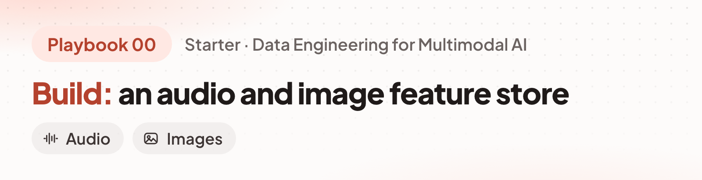
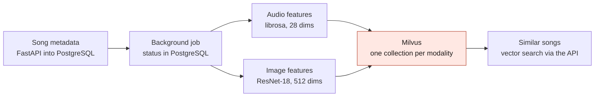

<picture>
  <source media="(prefers-color-scheme: dark)" srcset="docs/img/header-dark.png">
  
</picture>

# Playbook 00: Find songs that sound alike or look alike
**How to build an audio and image feature store with Milvus.** A companion playbook for [*Data Engineering for Multimodal AI*](https://oreil.ly/data-engineering-multimodal) (O'Reilly, 2026). Not printed in the book.

[](https://github.com/Data-Engineering-for-Multimodal-AI/playbook-00-multimodal-feature-store-GTZAN/actions/workflows/smoke.yml)

[](LICENSE)
[](https://codespaces.new/Data-Engineering-for-Multimodal-AI/playbook-00-multimodal-feature-store-GTZAN?quickstart=1)

To find songs that sound alike or have similar album art, you need features for both and a fast way to compare them. In this repo, we explore this with the GTZAN music dataset. Follow along to extract audio and image features, store them in Milvus, and search for similar songs through an API.

**The problem.** Audio and images need different features, but you want one place to search both.

**What you'll work with.** You'll extract audio and image features, store them in a vector database (Milvus), process files as background jobs, and query everything through a REST API.

> The original steps are under [Run it the way the book does](#run-it-the-way-the-book-does) and still work as written. Want the repository as it was first published? Use the `first-edition` tag.

## Run it

You need [uv](https://docs.astral.sh/uv/), `make` and Docker (PostgreSQL and Milvus run in containers). Or open the repo in a GitHub Codespace, where all of them are ready. On Windows without `make`, use a Codespace or the original steps below.

`make run` uses synthetic clips: tones and noise in three made-up genres, with a spectrogram image for each, written on the fly. The GTZAN recordings are not in this repository; step 5 downloads them.

**1. Get the code.** The clone is about 17 MB.

```bash
git clone https://github.com/Data-Engineering-for-Multimodal-AI/playbook-00-multimodal-feature-store-GTZAN.git
cd playbook-00-multimodal-feature-store-GTZAN
```

**2. Store features and search them.** Installs the locked dependencies and the ResNet-18 weights (`uv sync --frozen`), starts PostgreSQL and Milvus (`docker compose up -d --wait`), writes 12 synthetic clips, extracts audio and image features for each with the API's worker and stores them, then runs one similarity search per genre (`python quickstart.py`). On a busy Mac, with the services already created and the images downloaded, this took 1 min 36 s. The first start downloads about 3 GB of container images.

```bash
make run
```

You should see, for each query song, its three nearest songs by audio and then by image:

```
12 clips in 3 genres
Stored features for 12 songs in PostgreSQL and Milvus

Most similar songs by audio (cosine similarity):
  synthetic_bass.00000
    0.9948  synthetic_bass.00001
    0.8144  synthetic_bass.00002
    0.7497  synthetic_bass.00003
...
  Same genre as the query: 9 of 9
```

PostgreSQL holds each song's metadata and file paths, Milvus one 28-number audio vector and one 512-number image vector per song. If another PostgreSQL already uses port 5433 on your machine, set `POSTGRES_PORT` to a free port first.

**3. Search with a file yourself.** Encodes any WAV file (or image) with the same encoder and searches the stored songs (`python scripts/similar.py`).

```bash
make similar FILE=mmfeaturestore/output/synthetic/genres_original/synthetic_bass/synthetic_bass.00000.wav
```

```
Most similar songs by audio to mmfeaturestore/output/synthetic/genres_original/synthetic_bass/synthetic_bass.00000.wav (cosine similarity):
  1.0000  synthetic_bass.00000
  0.9948  synthetic_bass.00001
  0.8144  synthetic_bass.00002
  0.7497  synthetic_bass.00003
  0.2229  synthetic_treble.00000
```

The clip finds itself first, at 1.0000, then the other bass clips; the first treble clip is far behind. Pass a `.png` to search by image instead.

**4. The API (optional).** Starts the services, then the REST API on http://localhost:8000 (`python run.py`). The endpoints and a full example are under [Usage](#usage). We didn't time this step.

```bash
make serve
```

**5. GTZAN (optional, Kaggle account).** Downloads GTZAN from Kaggle into `mmfeaturestore/sample_data/` (`python download_data.py`, 1.2 GB; needs a Kaggle API token), then runs step 2 on five clips per genre. We didn't run this step for this update.

```bash
make data
make run-gtzan
```

**6. Clean up.**

```bash
make clean
```

This stops PostgreSQL and Milvus and deletes their volumes (every stored song and vector), and removes `mmfeaturestore/output/` (the synthetic clips and the experiments' files) and the test cache. Downloaded GTZAN data in `mmfeaturestore/sample_data/` and the installed packages stay. To stop the services and keep the data, run `docker compose stop` instead.

## How much time do you have?

| Time | What to do |
|---|---|
| 15 minutes | [Run it](#run-it), steps 1 to 3. On a busy Mac, step 2 took 1 min 36 s with the container images already downloaded. |
| 1 hour | The three [Try this](#try-this) experiments, then `make similar` with your own WAV files. |
| 1 day | Download GTZAN (step 5), [use your own data](#use-your-own-data), and work through [Before production](#before-production). |

## Try this

Each experiment changes one thing and measures the effect on synthetic clips the script writes (three made-up genres: bass tones, treble tones and noise bursts). They use the repo's encoders and rank by cosine similarity, the metric the Milvus collections use, so they need no Docker. The numbers below are from a busy Mac on 2026-11-21; times are left out because the machine was loaded.

**1. What does standardizing the audio features do?** The 28 audio features mix units: two of them, the spectral centroid and rolloff, are in thousands of Hz. The encoder standardizes each feature with `models/audio_scaler.json` (statistics over 999 GTZAN clips) before normalizing. This encodes 24 clips with and without that step.

```bash
make try-scaler
```

```
audio features    nearest is same genre  same genre  other genres     gap  pairs above 0.98
standardized                       96%       0.741        -0.053   0.794         35 of 276
raw                               100%       1.000         0.990   0.010        276 of 276
```

Without standardizing, every pair of clips scores above 0.98: the nearest clip is still right, but a similarity threshold or a score shown to a user means nothing. With it, clips of other genres average below 0. One clip in 24 now finds a clip of another genre first. Change which features `src/encoders/audio.py` scales and run it again.

**2. How much of the spectrogram does the image encoder see?** The image encoder resizes each image to a short side of 256 pixels and keeps the center 224 x 224 for ResNet-18. This blacks out parts of 12 spectrogram images (432 x 288, the size `quickstart.py` writes) and compares the vectors with the originals.

```bash
make try-image-crop
```

```
12 spectrogram images of 432 x 288; the encoder keeps x 90-342, y 18-270
That is 58% of the clip's duration and 88% of its mel bands.

blacked out                       share of pixels  similarity to the original vector
first and last 20% of the time                40%                             1.0000
top and bottom 5% of the bands                10%                             1.0000
middle 40% of the time                        40%                             0.6152
middle 10% of the bands                       10%                             0.8674
```

The image features never see the first and last fifth of the clip: blacking them out changes nothing. For a 30-second clip drawn at that size, that is about 13 seconds. The `transforms` in `src/encoders/image.py` decide this; try `transforms.Resize((224, 224))` and run it again.

**3. Which modality copes with a noisy recording?** Stores 18 clean clips, then searches with noisy copies (white noise at a falling signal-to-noise ratio), by audio features and by the spectrogram image.

```bash
make try-noise
```

```
    SNR  audio: finds itself  same genre  image: finds itself  same genre
  clean                 100%         94%                 100%        100%
  30 dB                  94%         94%                  83%        100%
  20 dB                  89%         94%                  67%        100%
  10 dB                  72%         94%                  50%        100%
   0 dB                  28%         67%                  22%        100%
 -10 dB                   6%         33%                   6%         56%
```

Neither finds the exact clip once the noise is loud, but the image features keep finding the right genre down to 0 dB, where the audio features drop to 67%. The two modalities fail differently, which is a reason to store both. Change `SNR_DB` in `experiments/noise.py`, or the noise itself.

## Use your own data

Put your clips in a folder with GTZAN's layout:

```
my_music/
  genres_original/<genre>/<name>.<number>.wav      audio, any sample rate (read at 22,050 Hz)
  images_original/<genre>/<genre><number>.png      optional: one image per clip
```

The image for `genres_original/jazz/take.00007.wav` is `images_original/jazz/jazz00007.png`, as in GTZAN. A clip without an image is stored with audio only. Each song's ID is the first 36 characters of its file name. Check the folder first. This reads every file and stores nothing:

```bash
make check-data DIR=my_music
```

It reports every file it can't use and why: a file that isn't `.wav`, an empty or unreadable WAV, a clip shorter than 1 s or completely silent, a Git LFS pointer, an image that won't open or is smaller than 32 x 32, and two files that would get the same song ID. On a folder with deliberate mistakes:

```
7 problems in my_music; nothing was stored:
  genres_original/synthetic_bass/quiet.00010.wav: silent (every sample is 0)
  genres_original/synthetic_bass/short.00011.wav: 0.50 s long, needs at least 1 s
  images_original/synthetic_bass/synthetic_bass00001.png: a Git LFS pointer, not the image (run git lfs pull)
  images_original/synthetic_bass/synthetic_bass00002.png: too small (16x16), needs at least 32x32
  genres_original/synthetic_treble/song.mp3: not a .wav file (only .wav is read; convert it first)
  genres_original/synthetic_treble/broken.00012.wav: can't read as WAV audio (LibsndfileError)
  genres_original/synthetic_treble/synthetic_bass.00000.wav: same song ID 'synthetic_bass.00000' as genres_original/synthetic_bass/synthetic_bass.00000.wav (IDs are the first 36 characters of the name)
```

When everything passes, store every clip and search them. This starts the services if needed and runs step 2 on your folder (`python quickstart.py --data my_music`):

```bash
make load DIR=my_music
```

```
my_music: OK, 8 clips in 2 genres, 8 with an image
...
Stored features for 8 songs in PostgreSQL and Milvus
```

This took 1 min 27 s for 8 clips on the same Mac. Songs already stored under the same ID are replaced; other stored songs stay, so `make similar` searches all of them. `make clean` empties the store.

## What you end up with

A feature store with your clips in it, one audio vector and one image vector per song, searchable by file or through an API, and three measurements of what the features keep and lose.

Skills you'll practice:
- Extracting hand-built audio features and CNN image features from the same recordings
- Standardizing features with stored statistics before comparing them
- Storing vectors in Milvus and metadata in PostgreSQL, keyed by the same ID
- Checking what a preprocessing step drops before trusting its features
- Comparing how each modality degrades on noisy input
- Validating input files before they reach the pipeline

## Before production

This playbook runs a few clips on one machine. Before you run something like it for real:

1. **Version the scaler with the vectors.** Audio vectors depend on `models/audio_scaler.json`: without it, every pair of clips scored above 0.98 ([Try this 1](#try-this)). If the file changes or is missing (the encoder only logs a warning), old and new vectors no longer compare. Store the scaler's version with each vector and re-encode when it changes. *Chapter 5, "Preprocessing as Feature Engineering" (page 138); Chapter 8, "Data Versioning and Experiment Tracking for Multimodal AI" (page 276).*
2. **Check what preprocessing drops.** The image transform keeps 58% of a spectrogram's duration ([Try this 2](#try-this)). Resize to the model's input without cropping, or split long clips into windows. *Chapter 5, "Extracting Features Across Modalities" (page 139).*
3. **Search both modalities and combine them.** Under noise, image features kept the genre down to 0 dB while audio features fell to 67% ([Try this 3](#try-this)). Query both collections and merge the results, and measure the merge. *Chapter 5, "Feature Selection and Fusion in Multimodal Contexts" (page 143).*
4. **Pick the index for the collection size.** Both collections use IVF_FLAT with `nlist=1024` and search with `nprobe=10`; with 12 songs, that index has more clusters than vectors. Measure recall and latency at your size before choosing. *Chapter 6, "Vector Databases" (page 180).*
5. **Use stable song IDs.** `quickstart.py` uses the first 36 characters of the file name as the ID, so two files can collide (`make check-data` catches it within one folder, not against songs already stored). Assign IDs when a song is registered. *Chapter 5, "Why Feature Stores Are Needed" (page 155).*
6. **Process in a queue with retries.** The API runs extraction as asyncio tasks inside its own process, and a job that fails stays failed. Put jobs on a queue with workers, retries and a dead-letter list. *Chapter 2, "Production Patterns for Reliability and Scale" (page 51).*
7. **Watch the store.** Track jobs per status, extraction time per modality and search latency, and alert when Milvus is down; today the worker only logs "vector operations will be disabled". *Chapter 2, "Monitoring and Observability" (page 53).*
8. **Lock down the services.** PostgreSQL and MinIO use development passwords from `docker-compose.yml`, and the API has no authentication. *Chapter 11, "Protecting Data Across the Pipeline" (page 421).*
9. **Respect the recordings' rights.** GTZAN's audio comes from commercial recordings and isn't redistributed here. Record source and license for every clip you store. *Chapter 11, "Lineage and Provenance Tracking" (page 416).*

## What it costs

| Where you run it | Cost |
|---|---|
| Your machine | $0. Everything runs locally: no API keys, no paid services. A Kaggle account (free) only for GTZAN. The clone is about 17 MB, the Python environment 1.2 GB, and the PostgreSQL and Milvus images about 3.3 GB. |
| A GitHub Codespace (4 cores, 16 GB, the size this repo asks for) | Estimated $0.36 per hour at GitHub's list price (November 2026). A free personal account includes 120 core-hours a month, about 30 hours on this machine. In CI, `make run` in a freshly built devcontainer, including the first start of PostgreSQL and Milvus, took 85 s. |

## How it works



This feature store provides a comprehensive solution for processing and retrieving music data across multiple modalities (audio and image). The system extracts meaningful features from audio files and album artwork, stores them in optimized vector databases, and enables powerful similarity searches to find music with similar acoustic properties or visual aesthetics.

### Key Features

- **Multimodal Feature Extraction**: Extract rich feature vectors from both audio files and images
- **Vector Similarity Search**: Find songs with similar audio characteristics or visual album art
- **Asynchronous Processing**: Background job processing for handling large files
- **REST API Interface**: Simple HTTP endpoints for all operations
- **Modular Architecture**: Easy to extend with new modalities or encoder models

## Architecture

The feature store uses a modular architecture with several key components:

- **PostgreSQL**: Stores metadata and job status information
  - Song metadata (artist, title, etc.)
  - Data file paths
  - Processing job status tracking

- **Milvus**: Vector database for storing and querying high-dimensional feature vectors
  - Efficient storage of audio and image feature vectors
  - Fast approximate nearest neighbor search
  - Separate collections for each modality (audio/image)

- **FastAPI**: REST API for interacting with the feature store
  - Asynchronous request handling
  - Data validation with Pydantic
  - Background tasks for long-running operations

- **Encoder Models**: Specialized audio and image encoders that extract features from raw files
  - Audio: 28-dimensional feature vectors capturing timbre, rhythm, etc.
  - Image: 512-dimensional feature vectors using CNN-based model

### Data Model

The system uses the following data model:

- **Song**: Core entity representing a music track
  - Unique ID (UUID)
  - Metadata (title, artist, album, genre, year)
  - Data paths for different modalities

- **Job**: Represents a feature extraction process
  - Unique ID (UUID)
  - Associated song ID
  - Status for each modality (pending, processing, processed, error)
  - Timestamps

- **Feature Vector**: Generated embeddings for each modality
  - Song ID reference
  - Modality type (audio/image)
  - High-dimensional vector data

## Run it the way the book does

The book doesn't print this repository; these are the original steps, and they still work as written.

### System Requirements

- **CPU**: 2+ cores recommended (4+ for faster processing)
- **RAM**: Minimum 4GB (8GB+ recommended, especially for processing multiple files)
- **Storage**: 
  - 500MB for application code
  - 1GB+ for sample data
  - Additional space for your music collection
- **Operating System**: Linux, macOS, or Windows with Docker support

### Prerequisites

- **Python 3.12+**
- **Docker** (runs PostgreSQL and Milvus)
- **Docker Compose** 2.20 or newer

### Installation Steps

1. Clone the repository:
   ```bash
   git clone https://github.com/Data-Engineering-for-Multimodal-AI/playbook-00-multimodal-feature-store-GTZAN.git
   cd playbook-00-multimodal-feature-store-GTZAN
   ```

2. Install dependencies:
   ```bash
   pip install -r requirements.txt
   ```

3. PostgreSQL runs in Docker with Milvus (next step). It listens on host port 5433, with user
   `featurestore_user`, password `featurestore` and database `featurestore`. To use a PostgreSQL you
   installed yourself instead, create the user and database and point the API at it:
   ```bash
   createuser --createdb featurestore_user
   createdb -O featurestore_user featurestore
   export POSTGRES_PORT=5432
   ```

4. Start PostgreSQL and the Milvus service:
   ```bash
   # Using Docker Compose (recommended)
   docker-compose up -d
   ```

   Verify Milvus is running:
   ```bash
   # Check container status
   docker ps | grep milvus
   
   # Check Milvus logs for any issues
   docker logs milvus-standalone
   
   # Test connection to Milvus
   curl http://localhost:9091/healthz
   ```
   
   If you need to restart Milvus:
   ```bash
   docker-compose down
   docker-compose up -d
   ```

5. Start the API server:
   ```bash
   cd mmfeaturestore
   python run.py
   ```

## Sample Data

The repository does not include the audio or image files. `make data` downloads the GTZAN dataset from Kaggle into `mmfeaturestore/sample_data/` (needs a Kaggle API token). The files are organized as follows:

- **Audio samples**: Located in `/mmfeaturestore/sample_data/genres_original/{genre}/*.wav`
- **Image samples**: Located in `/mmfeaturestore/sample_data/images_original/{genre}/*.png`

Genres include: pop, rock, jazz, classical, metal, blues, disco, reggae, hiphop, and country.

### Obtaining Sample Data

To get the data, you can:

1. Download the GTZAN dataset for audio samples: [GTZAN on Kaggle](https://www.kaggle.com/datasets/andradaolteanu/gtzan-dataset-music-genre-classification). `make data` downloads it into `mmfeaturestore/sample_data/` (needs a Kaggle API token).
2. Place audio files in the appropriate genre folders under `mmfeaturestore/sample_data/genres_original/`
3. Place one image per clip in the corresponding folders under `mmfeaturestore/sample_data/images_original/`. The Kaggle download includes a mel spectrogram image for each clip.

## Usage

### REST API Endpoints

- `POST /songs`: Create a new song record
- `PUT /songs/{song_id}/data/{modality}`: Add data path for a specific modality
- `POST /songs/{song_id}/process`: Process features for a song
- `GET /jobs/{job_id}`: Get processing job status
- `GET /songs/{song_id}/features/{modality}`: Get extracted features for a modality
- `POST /songs/{song_id}/similar`: Find similar songs based on features

### Example: Processing a New Song

```python
import requests
import json
import uuid

# API base URL
BASE_URL = "http://localhost:8000"

# Create a new song
song_id = str(uuid.uuid4())
song_data = {
    "id": song_id,
    "title": "Rock Sample",
    "artist": "Sample Artist",
    "album": "Rock Collection",
    "genre": "rock",
    "year": 2024
}

response = requests.post(f"{BASE_URL}/songs", json=song_data)
print(f"Created song: {response.json()}")

# Set audio and image paths
audio_path = "/path/to/audio.wav"
image_path = "/path/to/cover.png"

requests.put(
    f"{BASE_URL}/songs/{song_id}/data/audio", 
    json={"path": audio_path}
)
requests.put(
    f"{BASE_URL}/songs/{song_id}/data/image", 
    json={"path": image_path}
)

# Process features
response = requests.post(
    f"{BASE_URL}/songs/{song_id}/process", 
    json={"modalities": ["audio", "image"]}
)
job_id = response.json()["job_id"]

# Check job status
response = requests.get(f"{BASE_URL}/jobs/{job_id}")
print(f"Job status: {response.json()}")

# Find similar songs
response = requests.post(
    f"{BASE_URL}/songs/{song_id}/similar",
    json={"modality": "audio", "top_k": 5}
)
print(f"Similar songs: {response.json()}")
```

## Testing Scripts

The repository includes several test scripts for exploring and validating the feature store functionality:

1. `test_new_song.py`: Tests creating a single song, extracting features, and performing similarity search
2. `explore_genres.py`: Processes samples from different music genres and compares similarities between them
3. `test_features.py`: Validates feature extraction for different modalities
4. `test_similarity.py`: Tests similarity search functionality
5. `test_api_curl.sh`: Example cURL commands for interacting with the API

## Feature Extraction Process

1. **Audio Features**:
   - Processes WAV files to extract a 28-dimensional feature vector
   - Features capture timbral, rhythmic, and harmonic characteristics
   - Each feature is standardized with the mean and standard deviation in `mmfeaturestore/models/audio_scaler.json` (measured over 999 GTZAN clips), then the vector is normalized to length 1. Without this step, the spectral centroid and rolloff, measured in thousands of Hz, outweigh the other 26 features, and every clip scores about 1.0 against every other one. In `make run`, the synthetic clips' audio similarities went from 0.9999 to 1.0000 without it to between 0.52 and 0.9995 with it.

2. **Image Features**:
   - Processes PNG/JPEG album artwork using deep learning models
   - Extracts a 512-dimensional feature vector capturing visual characteristics

## Troubleshooting

### Known Issues

1. **Milvus Connection**: Ensure Milvus is running before starting the server:
   ```bash
   docker ps | grep milvus
   ```
   If Milvus isn't running, restart it with:
   ```bash
   docker-compose up -d
   ```

2. **Numpy Serialization Error**: When accessing feature endpoints directly, you may encounter:
   ```
   TypeError: 'numpy.float32' object is not iterable
   ```
   This is due to serialization issues with raw numpy vectors. Use the `/similar` endpoint instead which properly serializes the results.

3. **Bottleneck Warning**: You may see a warning about the bottleneck library version:
   ```
   UserWarning: Pandas requires version '1.3.6' or newer of 'bottleneck' (version '1.3.5' currently installed).
   ```
   This is a non-critical warning and can be safely ignored, or you can update bottleneck with:
   ```bash
   pip install --upgrade bottleneck
   ```

4. **Port Already In Use**: If you see an error like:
   ```
   [Errno 48] error while attempting to bind on address ('0.0.0.0', 8000): address already in use
   ```
   Kill the existing process using port 8000:
   ```bash
   lsof -i :8000
   kill <PID>
   ```

### 1. Milvus Connection Issues

If you see:
```
ERROR: Failed to connect to Milvus: <MilvusException: (code=2, message=Fail connecting to server on localhost:19530)>
WARNING: Failed to connect to Milvus, vector operations will be disabled
```

**Solution:**

First verify Milvus is running:
```bash
# Check if Milvus containers are running
docker ps | grep milvus
```

If containers are not running:
```bash
# Start Milvus and related services
docker-compose up -d
```

If containers are running but you still can't connect:
```bash
# Check Milvus logs for errors
docker logs milvus-standalone

# Restart Milvus containers
docker-compose restart

# If problems persist, recreate the containers
docker-compose down
docker-compose up -d
```

Common issues:
- Docker not running
- Port 19530 is in use by another application
- Insufficient memory for Milvus (check Docker resource limits)
- Corrupted Milvus data (check logs for any data errors)

## Dependencies

- `fastapi`: Web framework for the API
- `pymilvus`: Client for Milvus vector database
- `asyncpg`: Async PostgreSQL client
- `numpy`: Numerical computing
- `librosa`: Audio processing
- `torchvision`: Image processing
- `pandas`: Data manipulation
- `pydantic`: Data validation
- `uvicorn`: ASGI server

If this playbook helped you, a star helps other readers find it.

## License

This project is licensed under the MIT License - see the [LICENSE](LICENSE) file for details.

The datasets and models this playbook uses keep their own licenses. See [DATA_SOURCES.md](DATA_SOURCES.md).

The MIT License is a permissive license that allows for reuse with few restrictions. You are free to use, copy, modify, merge, publish, distribute, sublicense, and/or sell copies of the software, provided that the original copyright notice and permission notice appear in all copies.

## What to Expect When Running

### Starting the Server

When running `python run.py` to start the server, you should see:

```
INFO: NumExpr defaulting to 8 threads.
INFO: Started server process [XXXXX]
INFO: Waiting for application startup.
INFO: Connected to PostgreSQL at 127.0.0.1:5433/featurestore
INFO: Created tables if they didn't exist
INFO: Connected to Milvus at localhost:19530
INFO: Connected to Milvus
INFO: Application startup complete.
INFO: Uvicorn running on http://0.0.0.0:8000 (Press CTRL+C to quit)
```

If Milvus is not running, you'll see an error like:
```
ERROR: Failed to connect to Milvus: <MilvusException: (code=2, message=Fail connecting to server on localhost:19530)>
```

### Creating and Processing a Song

When creating and processing a song through the API, expect:

1. **Creating a song**: Returns a JSON response with the song ID
2. **Setting data paths**: Returns a confirmation message
3. **Processing features**: Returns a job ID for tracking
4. **Job status polling**: Shows progression from "pending" to "processing" to "processed" for each modality
5. **Similarity search**: Returns a list of similar songs with IDs and similarity scores

If you run the included `test_new_song.py` script, you'll see output like:
```
INFO: Created song: 7f218e3d-cb99-4fb4-b9ea-d0ff85c18ace
INFO: Updated data path for song 7f218e3d-cb99-4fb4-b9ea-d0ff85c18ace / audio
INFO: Updated data path for song 7f218e3d-cb99-4fb4-b9ea-d0ff85c18ace / image
INFO: Created job: 991240fa-3b3e-42a8-bdf2-5ec80add9732
INFO: Generated audio features with shape: (28,)
INFO: Inserted embedding for song in modality audio
INFO: Generated image features with shape: (512,)
INFO: Inserted embedding for song in modality image
```

### Common Error Patterns

1. **Milvus not running**:
   ```
   WARNING: Failed to connect to Milvus, vector operations will be disabled
   WARNING: Milvus not connected, skipping feature storage for audio
   ```
   Fix by starting the Milvus server.

2. **Feature retrieval errors**:
   Direct feature access may show errors due to numpy serialization issues:
   ```
   TypeError: 'numpy.float32' object is not iterable
   ```
   This is why the `/similar` endpoint should be used instead of direct feature access.

3. **Port conflicts**:
   ```
   ERROR: [Errno 48] error while attempting to bind on address ('0.0.0.0', 8000): address already in use
   ```
   Fix by killing other processes using port 8000.

## Step-by-Step Implementation Guide

Follow this guide to set up and use the feature store with the included sample data.

### 1. Setting Up The Environment

First, ensure all dependencies are installed:

```bash
pip install -r requirements.txt
```

Expected output:
```
Successfully installed pymilvus-2.3.1 fastapi-0.103.1 uvicorn-0.23.2 asyncpg-0.28.0 librosa-0.10.1 torchvision-0.16.0 ...
```

### 2. Starting the PostgreSQL Database

PostgreSQL starts with Milvus in the next step (`docker-compose up -d`), on host port 5433. If you
use your own PostgreSQL instead, create the user and database and set `POSTGRES_PORT`:

```bash
createuser --createdb featurestore_user
createdb -O featurestore_user featurestore
export POSTGRES_PORT=5432
```

### 3. Starting Milvus with Docker

Start the Milvus vector database:

```bash
docker-compose up -d
```

Expected output:
```
Creating network "mmfeaturestore_default" with the default driver
Creating mmfeaturestore_etcd_1         ... done
Creating mmfeaturestore_minio_1        ... done
Creating mmfeaturestore_standalone_1   ... done
```

Verify Milvus is running:
```bash
docker ps | grep milvus
```

Expected output:
```
d6f3e0a9e0b2   milvusdb/milvus:v2.3.1   "/tini -- milvus run…"   2 hours ago    Up 2 hours    0.0.0.0:19530->19530/tcp, 0.0.0.0:9091->9091/tcp   mmfeaturestore_standalone_1
```

### 4. Starting the API Server

Start the FastAPI server:

```bash
cd mmfeaturestore
python run.py
```

Expected output:
```
INFO: NumExpr defaulting to 8 threads.
INFO: Started server process [58006]
INFO: Waiting for application startup.
INFO: Connected to PostgreSQL at 127.0.0.1:5433/featurestore
INFO: Created tables if they didn't exist
INFO: Connected to Milvus at localhost:19530
INFO: Connected to Milvus
INFO: Application startup complete.
INFO: Uvicorn running on http://0.0.0.0:8000 (Press CTRL+C to quit)
```

### 5. Processing Sample Data

Run the sample processing script:

```bash
python test_new_song.py
```

This script processes a rock sample from the sample data. You'll see output like:

```
INFO: NumExpr defaulting to 8 threads.
INFO: Connected to PostgreSQL at 127.0.0.1:5433/featurestore
INFO: Using song ID: 610cd810-735b-4996-a94e-f5ed65ea1738
INFO: Updated audio path: mmfeaturestore/sample_data/genres_original/rock/rock.00000.wav
INFO: Updated image path: mmfeaturestore/sample_data/images_original/rock/rock00000.png
INFO: Processing features for audio and image
INFO: Generated audio features with shape: (28,)
INFO: Inserted embedding for audio in Milvus
INFO: Generated image features with shape: (512,)
INFO: Inserted embedding for image in Milvus
INFO: Processing complete
```

### 6. Testing Similarity Search

After processing some samples, you can test similarity search:

```bash
python test_similarity.py
```

Expected output:
```
INFO: Finding similar songs to Rock Sample 00000 by audio...
INFO: Found 3 similar songs:
1. Test Rock Song API (Score: 0.82)
2. Rock Sample 00000 (Score: 0.78)
3. Pop Sample 00032 (Score: 0.65)

INFO: Finding similar songs to Rock Sample 00000 by image...
INFO: Found 2 similar songs:
1. Pop Sample 00032 (Score: 0.71)
2. Direct Test Song (Score: 0.68)
```

### 7. Exploring Multiple Genres

To compare similarities across music genres:

```bash
python explore_genres.py
```

This will process sample files from each available genre and compare their similarities. Expected output:

```
INFO: Found 10 genres: ['pop', 'rock', 'jazz', 'classical', 'metal', 'blues', 'disco', 'reggae', 'hiphop', 'country']
INFO: Processing pop sample...
INFO: Generated audio features with shape: (28,)
INFO: Generated image features with shape: (512,)
INFO: Processing rock sample...
INFO: Generated audio features with shape: (28,)
INFO: Generated image features with shape: (512,)
...
INFO: Processing country sample...
INFO: Finding audio similarities between genres...
INFO: Pop and Rock similarity: 0.65
INFO: Pop and Jazz similarity: 0.47
...
INFO: Finding image similarities between genres...
INFO: Pop and Rock similarity: 0.72
INFO: Pop and Jazz similarity: 0.53
...
```

### 8. Using the API Directly

You can also interact with the API directly using curl or other HTTP clients:

```bash
# Check server health
curl http://localhost:8000/health
# Expected: {"status":"ok"}

# Register a sample
curl -X POST http://localhost:8000/songs \
  -H "Content-Type: application/json" \
  -d '{"id":"sample123", "title":"Rock Sample", "artist":"Sample Artist", "album":"Rock Collection", "genre":"rock", "year":2024}'
# Expected: {"id":"sample123","title":"Rock Sample","artist":"Sample Artist","album":"Rock Collection","genre":"rock","year":2024}

# Set data paths
curl -X PUT http://localhost:8000/songs/sample123/data/audio \
  -H "Content-Type: application/json" \
  -d '{"path":"sample_data/genres_original/rock/rock.00000.wav"}'
# Expected: {"message":"Updated data path for song sample123 / audio"}

curl -X PUT http://localhost:8000/songs/sample123/data/image \
  -H "Content-Type: application/json" \
  -d '{"path":"sample_data/images_original/rock/rock00000.png"}'
# Expected: {"message":"Updated data path for song sample123 / image"}

# Process features
curl -X POST http://localhost:8000/songs/sample123/process \
  -H "Content-Type: application/json" \
  -d '{"modalities":["audio","image"]}'
# Expected: {"job_id":"991240fa-3b3e-42a8-bdf2-5ec80add9732"}

# Check job status
curl http://localhost:8000/jobs/991240fa-3b3e-42a8-bdf2-5ec80add9732
# Expected: {"id":"991240fa-3b3e-42a8-bdf2-5ec80add9732","status":{"audio":"processed","image":"processed"}}

# Find similar songs
curl -X POST http://localhost:8000/songs/sample123/similar \
  -H "Content-Type: application/json" \
  -d '{"modality":"audio","top_k":3}'
# Expected: {"similar":[{"id":"4f512e5a-...","score":0.82},{"id":"7f218e3d-...","score":0.78},{"id":"3a71b2c9-...","score":0.65}]}
```

## Common Issues and Troubleshooting

### 1. Milvus Connection Issues

If you see:
```
ERROR: Failed to connect to Milvus: <MilvusException: (code=2, message=Fail connecting to server on localhost:19530)>
WARNING: Failed to connect to Milvus, vector operations will be disabled
```

**Solution:**

First verify Milvus is running:
```bash
# Check if Milvus containers are running
docker ps | grep milvus
```

If containers are not running:
```bash
# Start Milvus and related services
docker-compose up -d
```

If containers are running but you still can't connect:
```bash
# Check Milvus logs for errors
docker logs milvus-standalone

# Restart Milvus containers
docker-compose restart

# If problems persist, recreate the containers
docker-compose down
docker-compose up -d
```

Common issues:
- Docker not running
- Port 19530 is in use by another application
- Insufficient memory for Milvus (check Docker resource limits)
- Corrupted Milvus data (check logs for any data errors)

### 2. Port Already in Use

If you see:
```
ERROR: [Errno 48] error while attempting to bind on address ('0.0.0.0', 8000): address already in use
```

**Solution:**
```bash
# Find process using port 8000
lsof -i :8000

# Kill the process
kill <PID>
```

### 3. Feature Retrieval Errors

If you see:
```
ValueError: [TypeError("'numpy.float32' object is not iterable"), TypeError('vars() argument must have __dict__ attribute')]
```

**Solution:** This is a known issue with direct feature retrieval. Use the `/similar` endpoint instead, which properly handles the serialization:

```bash
# Instead of:
# curl http://localhost:8000/songs/{song_id}/features/{modality}

# Use:
curl -X POST http://localhost:8000/songs/{song_id}/similar \
  -H "Content-Type: application/json" \
  -d '{"modality":"audio","top_k":3}'
```

## Project Structure

The repository is organized as follows. At the top level:

```
experiments/                      # Try this: scaler.py, image_crop.py, noise.py (make try-...)
scripts/                          # own_data.py (make check-data, make load), similar.py (make similar)
tests/                            # test_smoke.py (make smoke), test_own_data.py
mmfeaturestore/                   # the feature store, below
```

```
mmfeaturestore/
├── docker-compose.yml            # Docker configuration for Milvus
├── requirements.txt              # Python dependencies
├── run.py                        # Entry point to start the API server
├── test_new_song.py              # Basic test script
├── explore_genres.py             # Script to compare different genres
├── test_similarity.py            # Script to test similarity search
├── src/                          # Source code
│   ├── api/                      # API endpoints and route handlers
│   │   ├── main.py               # FastAPI application and routes
│   │   ├── models.py             # Pydantic models for requests/responses
│   │   └── endpoints/            # Endpoint implementations
│   ├── db/                       # Database connections and operations
│   │   ├── postgres.py           # PostgreSQL client
│   │   └── milvus.py             # Milvus client
│   ├── encoders/                 # Feature extraction modules
│   │   ├── audio.py              # Audio feature extraction
│   │   ├── image.py              # Image feature extraction
│   │   └── factory.py            # Encoder factory
│   └── worker/                   # Background job processing
│       └── tasks.py              # Async feature extraction tasks
└── sample_data/                  # Sample audio and image files
    ├── genres_original/          # Audio samples organized by genre
    └── images_original/          # Image samples organized by genre
```

### Key Components

- **API Layer**: Handles HTTP requests and responses (FastAPI)
- **Database Layer**: Manages data persistence (PostgreSQL and Milvus)
- **Encoder Layer**: Extracts features from raw files (Audio/Image processors)
- **Worker Layer**: Handles background processing of extraction tasks

## Contributing

Contributions to improve the feature store are welcome! Here's how you can contribute:

1. **Fork the repository**
2. **Create a feature branch** (`git checkout -b feature/amazing-feature`)
3. **Commit your changes** (`git commit -m 'Add some amazing feature'`)
4. **Push to the branch** (`git push origin feature/amazing-feature`)
5. **Open a Pull Request**

Before submitting a pull request, please:
- Ensure tests are passing
- Add documentation for new features
- Follow the existing code style

### Development Setup

For development, it's recommended to:
1. Create a virtual environment
2. Install dependencies with `pip install -r requirements.txt`
3. Install development dependencies with `pip install -r requirements-dev.txt` (if available)
4. Run tests before submitting changes

---

[The book](https://oreil.ly/data-engineering-multimodal) · [All playbooks](https://github.com/Data-Engineering-for-Multimodal-AI#playbooks) · Previous: [Playbook 00: end-to-end](https://github.com/Data-Engineering-for-Multimodal-AI/playbook-00-multimodal-end-to-end-pipeline)
<!-- Substack post for this playbook: add link here -->
